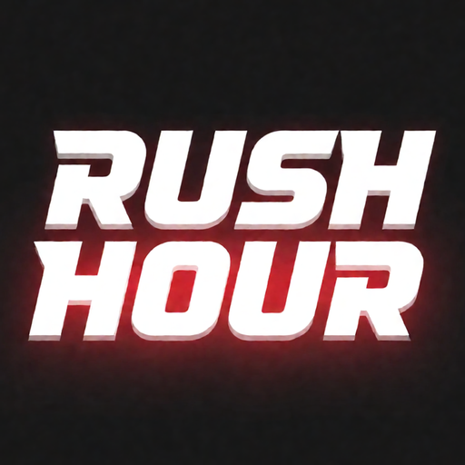
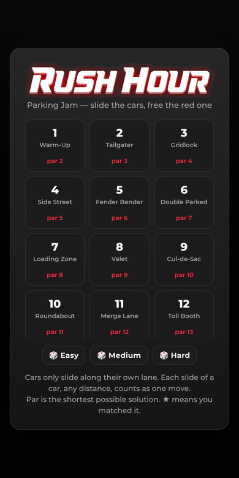
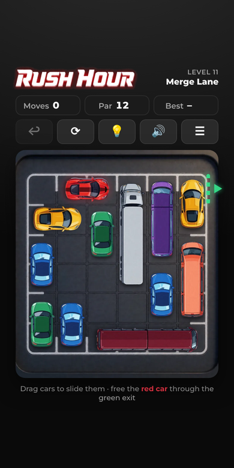
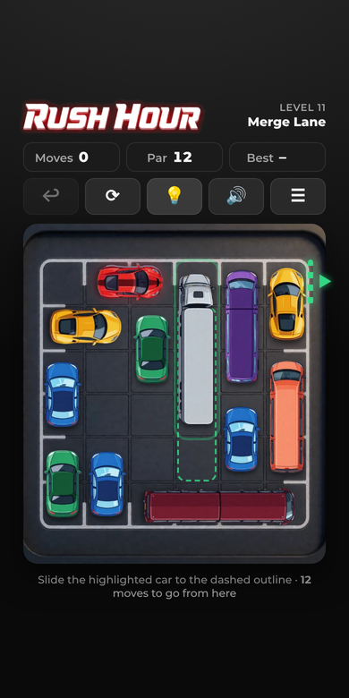

<p align="center"></p>

# Rush Hour · Parking Jam

A touch-first sliding-car puzzle for phones. Slide the cars and trucks along their lanes to clear a path, then drive the red sports car out through the green exit.

The whole game is one self-contained file, `index.html`. The car art, board, logo, font and sounds are all built in, so it works offline once loaded.

<p align="center">
  
  
  
</p>

## Play

Once GitHub Pages is on (see below), the game lives at `https://<your-username>.github.io/rush-hour/`. On a phone, use **Add to Home Screen** to get it with its own icon, full screen, like an app. You can also just open `index.html` in any modern browser.

## Features

- **21 campaign levels**, with par going from 2 moves to 35. Par is the true minimum, found by an exhaustive search of every reachable position.
- **Endless random puzzles** in Easy, Medium and Hard: 260 more puzzles, each generated and verified offline.
- **Vehicles 2 to 4 spaces long**: sedans, vans, a pickup, a semi truck and a bus.
- **Hints** that show the next move of a shortest solution from wherever you are, plus how many moves are left.
- **Undo, reset and best scores**, saved on the device. A ★ means you matched par.
- **Synthesized sound effects**: tire rolls, bumps, a honk for blocked cars, a vroom for the red car, and a rev-and-drive-off when you win. There's a mute button, and the setting is remembered.

## How it works

`index.html` has four scripts:

| Block | What's in it |
|---|---|
| `<script id="engine">` | The board model, a breadth-first solver (par and hints), and the level generator. It doesn't touch the page, so the tools below can run it in Node. |
| `<script id="levels">` | The campaign (`LEVELS`) and the random-mode puzzle banks (`BANK`). |
| `<script id="art">` | Car sprites and board art as embedded WebP images. |
| *(last script)* | The game itself: dragging, rendering, sound, menus and saved progress. |

A level is a list of vehicles, `[direction, row, column, length]`, with the red car first:

```js
{ name:'Warm-Up', cars:[['h',0,1,2], ['v',0,3,2], ['h',2,1,2], ['v',2,5,2]] }
```

Rows and columns run 0–5 from the top left. The red car must be horizontal, and it exits on the right side of its row. You don't write par anywhere: the game works it out when it loads.

## Level tools

You need Node 18 or newer. No packages to install.

```sh
# check every puzzle: valid layout, solvable, and its par
node tools/check-levels.js

# generate new puzzles (run a few in parallel with different seeds)
node tools/generate-bank.js --seconds 300 --out bank1.json --seed 1
node tools/generate-bank.js --seconds 300 --out bank2.json --seed 2

# rebuild the campaign and random banks in index.html from those puzzles
node tools/build-levels.js bank1.json bank2.json
node tools/check-levels.js
```

The generator scatters 11–14 vehicles at random, maps every position reachable from that layout, and keeps the one farthest from a solution. Most of these come out easy, so hard puzzles take volume: the shipped set came from tens of thousands of boards. The level names and par targets are at the top of `tools/build-levels.js`. The first three tutorial levels are hand-made and left alone. Run the generator and builder from the repository root, and don't commit the generated `bank*.json` files.

A GitHub Action runs `check-levels.js` on every push, so a broken level can't slip in.

## Publishing with GitHub Pages

1. Push this repository to GitHub.
2. Go to **Settings → Pages** and set **Source** to *Deploy from a branch*.
3. Choose the `main` branch, the `/ (root)` folder, and **Save**.

After a minute or so the game is live at `https://<your-username>.github.io/<repo-name>/`.

## Credits

- Game, solver and level generator by Richard Goates.
- Font: [Montserrat](https://github.com/JulietaUla/Montserrat), © The Montserrat Project Authors, used under the SIL Open Font License 1.1 (see `assets/Montserrat-OFL.txt`).

## License

The code is released under the MIT License; see [`LICENSE`](LICENSE). The artwork (vehicles, board and logo) is © Richard Goates, all rights reserved.
